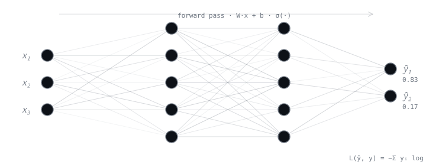

<div align="center">



$$\theta_{t+1} \;=\; \theta_t \;-\; \eta \, \nabla_{\theta} \, \mathcal{L}(\theta_t)$$

### $\textbf{Diegral}$

$\text{AI engineering} \;@\; \text{ESPOL}$

$\text{status: } \mathrm{student} \xrightarrow{\;\mathrm{epochs} \to \infty\;} \mathrm{ML\ engineer}$

</div>

---

```text
\documentclass[17pt]{human}
\usepackage{deep-learning}   % still in training
\usepackage{late-nights}
\author{Diegral}
```

---

<div align="center">

$\texttt{forward}$ — learning deep learning: backprop, CNNs, transformers, PyTorch

$\texttt{backward}$ — shipping in TypeScript · React Native · Supabase · Linux

$\texttt{loss}$ — $\mathcal{L}(\theta) \searrow 0$, one epoch at a time

</div>

---

<div align="center">

**selected work** — [TecniBus](https://github.com/diegraldev/TecniBus) · [AgentHQ](https://github.com/diegraldev/AgentHQ) · [CC.md](https://github.com/diegraldev/CC.md) · [Dynamic Islands](https://github.com/diegraldev/PlasmaKde-Dynamic-Islands) · [DIY Home Server](https://github.com/diegraldev/DIY-Home-Server)

</div>
